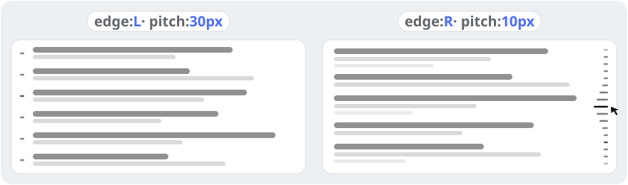
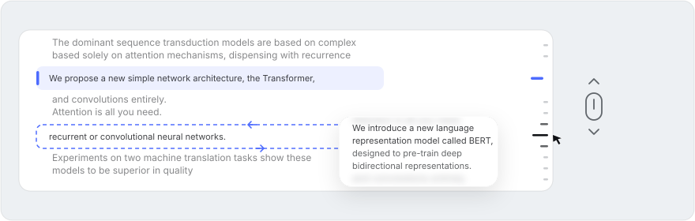
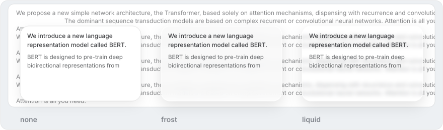
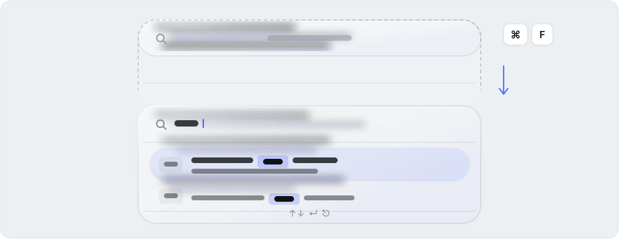

<p align="right"><a href="README.md">简体中文</a> · <a href="README.en.md">English</a></p>

# dsh-ui-outline

Never lose your place in long conversations. Place the rail your way, keep navigation in narrow columns, and search instantly with ⌘F / Ctrl+F.

A turn navigation rail and conversation search for [DeepSeek Harness](https://github.com/deepseek-ai/deepseek-harness).

<p align="center"></p>

[Install](#install) · [Settings](#settings)

## A rail that fits how you read

The rail hugs either edge of the conversation column, letting you combine docking side and tick density to match your reading habits. As illustrated below, **loose** density keeps ticks spaced and countable at a glance, while **compact** density accommodates hundreds of turns within a single viewport with smooth internal scrolling. The hit strip offers generous magnetic snapping so you never have to target thin lines—click anywhere or drag freely to glide across the session.

<p align="center"></p>

## Hover previews, wheel-speed browsing

Hover over any tick to reveal a frosted glass card showing that turn's prompt and response, confirming context before you jump. Rolling the wheel over the rail steps through turns sequentially: the dashed cursor and preview card travel with your scroll while **the conversation itself remains completely still**. Once you spot your target, click or press Enter to land with a subtle flash—glance first, commit second, eliminating weary back-and-forth paging in long sessions.

<p align="center"></p>

## Navigation that stays in narrow columns

Splitting your screen or opening a sidebar shrinks the conversation column and typically collapses native navigation; this rail stays pinned to the edge by default so rapid jumps never vanish. If you prefer an uncluttered reading layout, narrow columns can be configured to hide the rail automatically. Even when stowed, a subtle edge toggle remains in place so you can summon it back whenever needed.

## ⌘F / Ctrl+F to search the conversation

Press the shortcut to call up a Spotlight search bar; on the first keystroke, the capsule morphs seamlessly downward into a glass result card with identical corner curves. It supports whitespace-delimited AND matching across languages with highlighted context snippets, fully operable via keyboard (`↑` `↓` to navigate, `↵` to jump with a flash, `Esc` to dismiss). Background sliced indexing ensures silky typing regardless of conversation depth, while both the overlay and preview cards support live-switchable frosted glass, liquid glass, and opaque finishes.

Three materials side by side — opaque, frosted glass, and liquid glass — over the same turn:

<p align="center"></p>

<p align="center"></p>

<details>
<summary><b>Interaction details</b></summary>

- The search capsule is 52px high and shares one 26px corner radius across both states; the morph is a pure height growth with the radius never changing.
- Wheel stepping: starts at the current turn; 100 normalized scroll units per step with a 150ms idle remainder reset; drags and focus take the cursor over instantly.
- A 60ms input debounce plus sliced scanning keeps first-keystroke-to-results latency independent of conversation length.
- Liquid-glass search keeps a minimum effective blur of 10px for readability.

</details>

## Install

Requires dsh `>= 0.2.0-rc.1`. Supports the web client and the desktop app that reuses it.

```sh
dsh plugin --profile web add dsh-ui-outline
```

Restart `dsh web` after installation, then reload the page.

<details>
<summary><b>Other install methods</b></summary>

```sh
dsh plugin --profile web add github:iluluyu/dsh-ui-outline
dsh plugin --profile web add .   # run from the plugin directory; relative paths resolve from the invoking directory
dsh plugin --profile web add file:/absolute/path/to/plugin
```

Uninstall: `dsh plugin --profile web remove dsh-ui-outline`.

</details>

## Settings

Open **Plugins → dsh-ui-outline**; every option applies live.

| Setting | Options and defaults |
| --- | --- |
| Dock edge | Left / Right; defaults to Right |
| Tick density | Compact `compact` / Loose `loose`; defaults to Compact |
| Preview material | Opaque `none` / Frosted glass `frost` / Liquid glass `liquid`; defaults to Frosted glass |
| Narrow-column visibility | Show / Hide; defaults to Show |

<details>
<summary><b>Material parameters</b></summary>

Frosted glass defaults to transparency **80**, blur **6**; liquid glass is thinner, with its Standard preset at transparency **75**, blur **4**. The **Airy / Standard / Misty** presets update both values together without flashing the custom sliders. The search overlay follows the preview material setting.

</details>

## License

MIT © iluluyu
