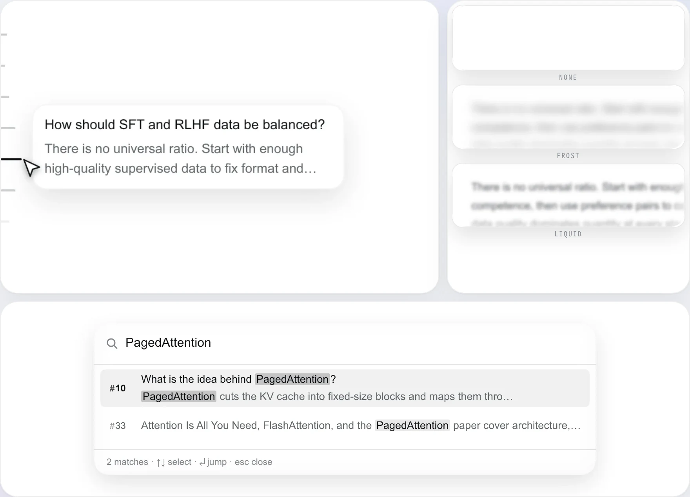
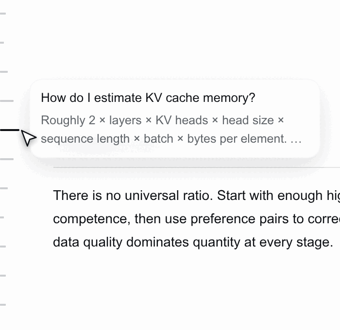
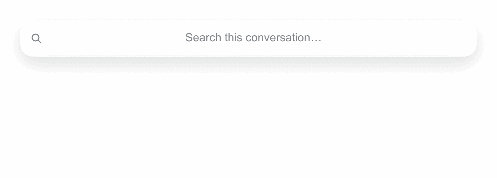

<p align="right"><a href="README.md">简体中文</a> · <a href="README.en.md">English</a></p>

# dsh-ui-outline

**Long conversations, without the scrolling.** Place the rail your way, keep it in narrow columns, search instantly with ⌘F.

A turn navigation rail and conversation search for [DeepSeek Harness](https://github.com/deepseek-ai/deepseek-harness).

<p align="center"></p>

[Features](#features) · [Install](#install) · [Settings](#settings)

## Features

- **Turn rail** — dock it left or right, at compact or loose tick density. A wide magnetic hit strip means clicks and drags both glide; long sessions scroll inside the rail.
- **Hover preview** — brush a tick to see that turn's prompt and response. The wheel steps turn by turn while **the conversation stays completely still**; click or press Enter to land with a flash.
- **Stays in narrow columns** — when split view or a sidebar squeezes the column, the rail stays pinned by default. Prefer a clean view? Hide it and a small edge toggle remains.
- **⌘F search** — a Spotlight-style bar that grows into a result card along the same corner radius. Whitespace AND, `"exact phrases"`, `-exclusions`, highlighted hits, full keyboard control (`↑` `↓` `↵` `esc`), and every answer step indexed — not just the last one.

<p align="center"></p>
<p align="center"><sub>Wheel stepping · conversation stays put</sub></p>

<p align="center"></p>
<p align="center"><sub>⌘F · hits as you type</sub></p>

<details>
<summary><b>Query syntax and details</b></summary>

| Input | Meaning |
| --- | --- |
| `preview card` | Multiple words are ANDed; each may hit a different step of the same turn |
| `"preview card height"` | Exact phrase, inside a single field |
| `-draft` / `-"foo bar"` | Exclude a word / exclude a phrase |
| `预览卡高度` | Pure CJK input (≥3 chars) tolerates 1–2 inserted characters, so it still finds `预览卡的高度` |

- Normalization: NFKC, zero-width removal, case folding. Mixed-script words stay whole.
- Every assistant step is indexed separately, so tool output and error text are searchable too; background sliced builds keep typing smooth.
- Results read in document order, showing the 50 nearest to where you are reading, with the exact total in the footer.

</details>

## Install

Requires dsh `>= 0.2.0-rc.1`.

**npm release**

```sh
dsh plugin --profile web add dsh-ui-outline
```

**Latest GitHub commit**

```sh
dsh plugin --profile web add github:iluluyu/dsh-ui-outline
```

Restart `dsh web` after installation, then reload the page.

<details>
<summary><b>Local path and uninstall</b></summary>

```sh
dsh plugin --profile web add .   # run from the plugin directory; relative paths resolve from the invoking directory
dsh plugin --profile web add file:/absolute/path/to/plugin
dsh plugin --profile web remove dsh-ui-outline
```

</details>

## Settings

Open **Plugins → dsh-ui-outline**; every option applies live.

| Setting | Options and defaults |
| --- | --- |
| Side | Left / Right; defaults to Right |
| Material | None / Frosted / Liquid glass; defaults to Frosted |
| Mark layout | Compact / Loose; defaults to Compact |
| Narrow column | Show / Hide; defaults to Show |

<details>
<summary><b>Material parameters</b></summary>

Frosted glass defaults to transparency **80**, blur radius **6**; liquid glass standard is **75** / **4**. The **Airy / Standard / Misty** presets update both values together, without flashing the custom sliders. The search overlay follows the preview material.

</details>

## License

MIT © iluluyu
