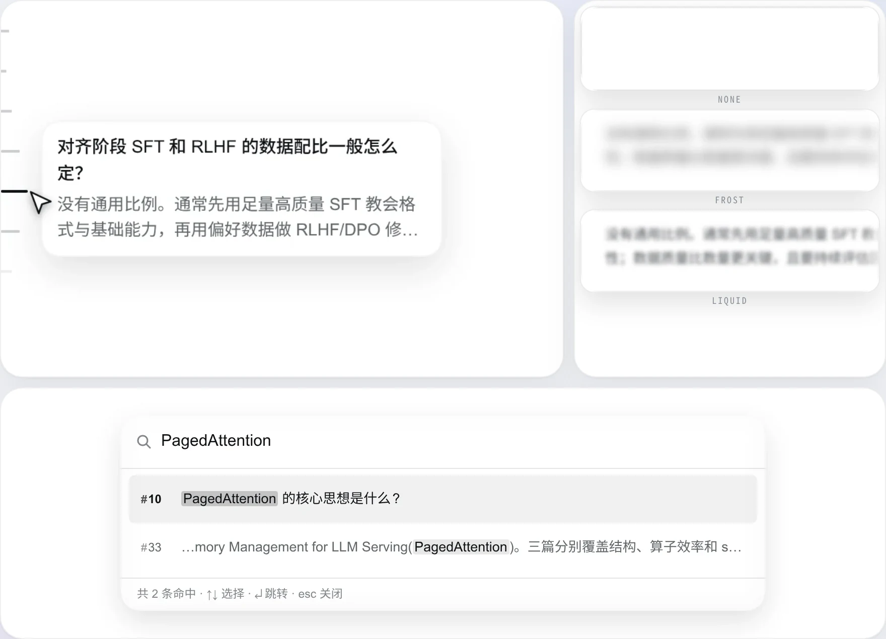
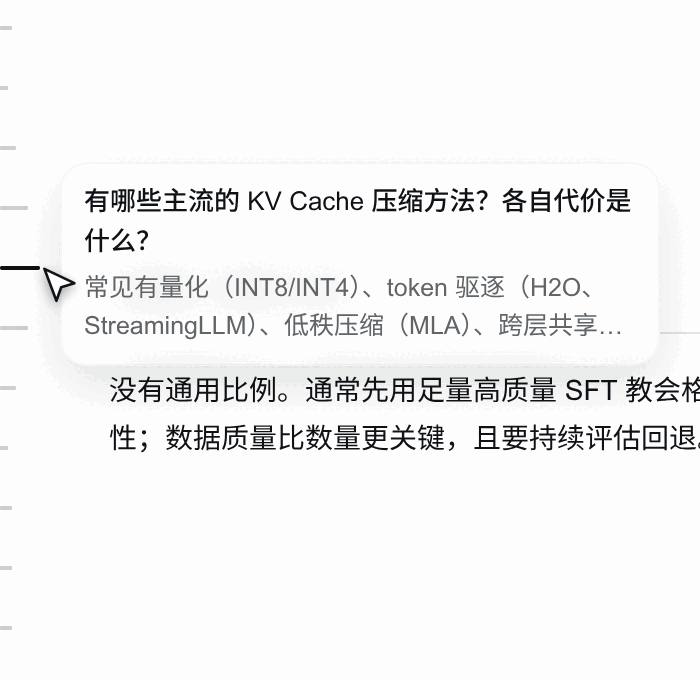
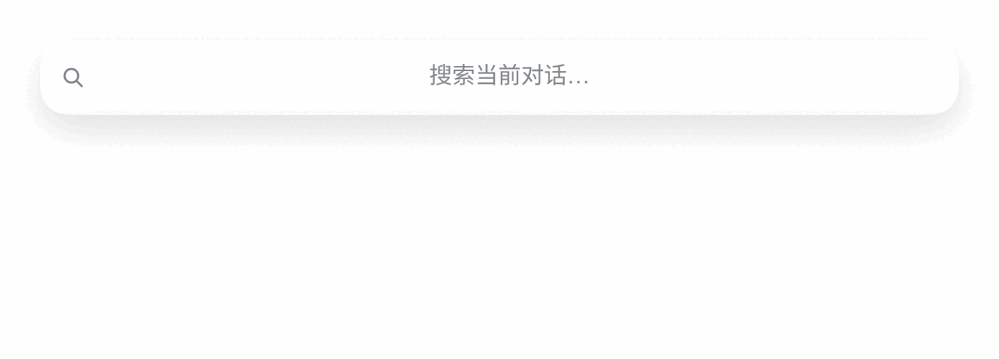

<p align="right"><a href="README.md">简体中文</a> · <a href="README.en.md">English</a></p>

# dsh-ui-outline

**长对话，不必来回翻。** 轨道随心摆放，窄列依然常驻，⌘F 即刻搜索。

为 [DeepSeek Harness](https://github.com/deepseek-ai/deepseek-harness) 打造的轮次导航轨与对话搜索。

<p align="center"></p>

[功能](#功能) · [安装](#安装) · [设置](#设置)

## 功能

- **导航轨** —— 贴左缘或右缘；紧凑 / 宽松两档刻度；宽域磁吸，点按或拖动都能穿梭；轮次超出后轨内平滑滚动。
- **悬停预览** —— 拂过刻度即浮出该轮的提问与回答；滚轮可逐轮步进，**正文始终原地不动**；点击或回车跳转，落点闪光。
- **轮次收藏** —— 点击预览卡右上角的星标收藏或取消；轨道内侧的圆点标记已收藏轮次。收藏只保存在当前浏览器，不跨浏览器或设备同步。
- **窄列常驻** —— 分屏、展开侧栏把列压窄时，轨道默认仍在；也可设为隐藏，列缘留一枚开关随时唤出。
- **⌘F 搜索** —— Spotlight 式搜索条，输入即沿同一圆角生长为结果卡；空格分词 AND、`"精确短语"`、`-排除`；命中高亮，`↑` `↓` `↵` `esc` 全键盘操作；索引覆盖每个回答步骤，不只是最后一条。

<p align="center"></p>
<p align="center"><sub>滚轮逐轮 · 会话原地待命</sub></p>

<p align="center"></p>
<p align="center"><sub>⌘F · 输入即命中</sub></p>

<details>
<summary><b>搜索语法与细节</b></summary>

| 输入 | 含义 |
| --- | --- |
| `预览 卡` | 多个词 AND，可分别命中同一轮的不同步骤 |
| `"预览卡高度"` | 精确短语，必须落在同一个字段内 |
| `-发灰` / `-"foo bar"` | 排除词 / 排除短语 |
| `预览卡高度` | 纯中文（≥3 字）允许有界容错：中间多 1–2 个字仍可命中 |

- 归一化：NFKC、去零宽、大小写折叠；中英混排不拆词，按整词匹配。
- 每个回答步骤单独索引，工具输出与报错文本也能搜到；后台分片构建，输入不卡顿。
- 结果按文档序排列，显示离当前阅读位置最近的 50 条，并在底部给出精确命中总数。

</details>

## 安装

需要 dsh `>= 0.2.0-rc.1`。

**npm 发布版**

```sh
dsh plugin --profile web add dsh-ui-outline
```

**GitHub 最新提交**

```sh
dsh plugin --profile web add github:iluluyu/dsh-ui-outline
```

安装后重启 `dsh web` 并刷新页面。

<details>
<summary><b>本地路径与卸载</b></summary>

```sh
dsh plugin --profile web add .   # 在插件目录下执行；相对路径以当前执行位置为准
dsh plugin --profile web add file:/absolute/path/to/plugin
dsh plugin --profile web remove dsh-ui-outline
```

</details>

## 设置

在 **插件 → dsh-ui-outline** 中调整，全部即时生效。

| 设置 | 选项与默认值 |
| --- | --- |
| 位置 | 左侧 / 右侧；默认右侧 |
| 材质 | 无材质 / 毛玻璃 / 液态玻璃；默认毛玻璃 |
| 刻度分布 | 紧凑 / 宽松；默认紧凑 |
| 窄列 | 显示 / 隐藏；默认显示 |

<details>
<summary><b>材质参数</b></summary>

毛玻璃默认透明度 **80**、虚化半径 **6**；液态玻璃标准预设 **75** / **4**。**清透 / 标准 / 朦胧**一次更新两项，不闪出自定义滑条。搜索浮层跟随预览材质。

</details>

## 许可

MIT © iluluyu
